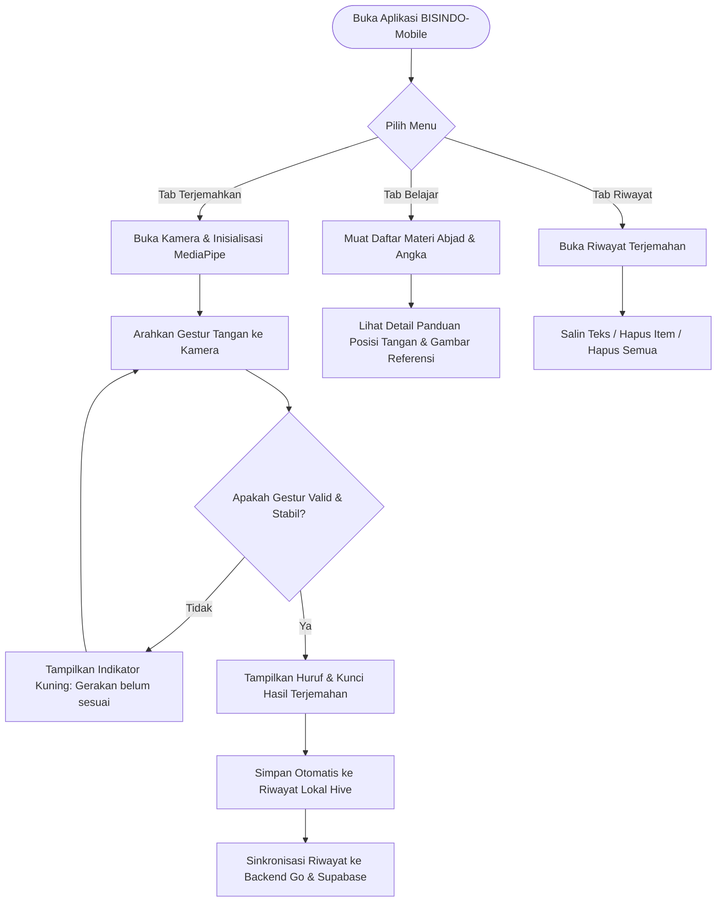
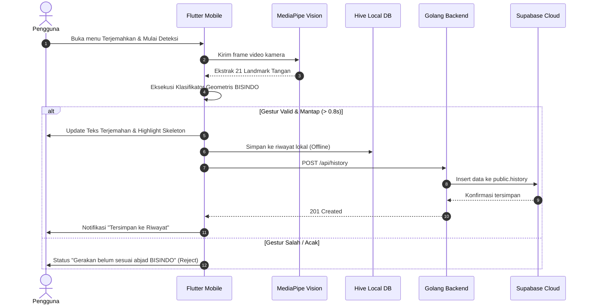
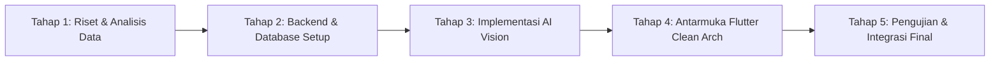

# 🤟 BISINDO-Mobile: Real-Time Indonesian Sign Language Translator & Learning Platform

[](https://flutter.dev)
[](https://dart.dev)
[](https://golang.org)
[](https://supabase.com)
[](https://ai.google.dev/edge/mediapipe)
[](#5-rancangan-arsitektur-dan-alur-sistem)
[](#5-rancangan-arsitektur-dan-alur-sistem)
[](#pengujian-testing)

---

## 📌 Catatan Penting Penilaian & Prinsip Proyek

> [!IMPORTANT]
> 1. **Realis dan Teruji**: Ide proyek bukan sekadar konsep di atas kertas. Solusi yang dirancang telah diuji coba secara langsung pada perangkat nyata, terbukti berjalan dengan latensi rendah pada kamera standar 30 FPS.
> 2. **Peran AI & Computer Vision Jelas & Berdampak**: MediaPipe Tasks Vision digunakan secara spesifik untuk mengekstraksi 21 koordinat spasial sendi tangan (X, Y, Z). Titik-titik ini kemudian dianalisis oleh *Geometric Landmark Classifier* untuk membedakan abjad secara presisi (misal pemisahan persilangan telunjuk huruf **X** vs alas segitiga jempol huruf **A**), sekaligus menolak gerakan tangan acak non-isyarat.
> 3. **Teknologi Sesuai Kebutuhan Nyata**: Mengombinasikan Flutter untuk responsivitas UI 60 FPS, Hive NoSQL untuk penyimpanan *offline-first* tanpa jeda, Golang untuk API berkecepatan tinggi dengan beban memori minimal, dan Supabase untuk kemudahan sinkronisasi cloud yang aman (*Row Level Security*).
> 4. **Implementasi Konkret, Bukan Sekadar Teori**: Proposal dan dokumentasi ini mencantumkan struktur arsitektur yang sudah terimplementasi, skema database riil, alur sekuensial sistem, serta rencana kerja terukur yang siap dinilai.

---

## 1. Judul dan Identitas Proyek

* **Nama / Judul Aplikasi**: **BISINDO-Mobile** (*Indonesian Sign Language Mobile Translator & Learning Assistant*)
* **Deskripsi Singkat Aplikasi**: 
  Aplikasi mobile lintas platform (didukung pada Android dan Web) yang berfungsi sebagai penerjemah bahasa isyarat Indonesia (BISINDO) secara *real-time* berbasis visi komputer (MediaPipe 21-Landmark) serta media edukasi interaktif untuk mempelajari abjad, angka, dan percakapan dasar BISINDO. Aplikasi ini mengusung pendekatan *offline-first* dengan penyimpanan lokal Hive dan sinkronisasi awan berbasis backend Golang (MVC + SOLID) yang terintegrasi dengan Supabase.
* **Identitas Anggota Kelompok**:
  1. **MUHAMMAD FAIZ RAMADHAN** (NIM: `2305072`)
  2. **NAILYAA DLIYAA’AN SYAH** (NIM: `2305075`)

---

## 2. Latar Belakang dan Permasalahan

### 2.1. Permasalahan yang Ingin Diselesaikan
* **Kesenjangan Komunikasi**: Mayoritas masyarakat umum tidak memahami bahasa isyarat alami Indonesia (BISINDO), sehingga Teman Tuli sering mengalami hambatan dalam mengakses layanan publik, pendidikan, pekerjaan, dan interaksi sosial harian.
* **Ketergantungan Juru Bahasa Isyarat (JBI)**: Jumlah penerjemah manusia bersertifikasi sangat terbatas dan tidak selalu tersedia setiap saat untuk kebutuhan mendesak.
* **Keterbatasan Aplikasi Penerjemah Isyarat Konvensional**: Sebagian besar aplikasi yang ada hanya berbasis kamus gambar statis atau memerlukan koneksi internet cepat (*cloud-inference*) yang lambat dan berpotensi menimbulkan isu privasi rekaman video kamera pengguna.

### 2.2. Alasan Aplikasi Perlu Dikembangkan
* **Aksesibilitas & Inklusi Sosial**: Memberikan sarana komunikasi dua arah yang praktis dan portabel langsung dari genggaman ponsel.
* **Privasi dan Kecepatan Real-Time**: Menggunakan model *on-device vision processing* sehingga pemrosesan video berjalan instan tanpa harus mengunggah frame video ke internet.
* **Penyelarasan Standar Bahasa Alami**: Menghadirkan materi dan klasifikasi gestur yang sesuai dengan karakter alami BISINDO (didukung pose 1 tangan maupun 2 tangan).

### 2.3. Target Pengguna Aplikasi
1. **Teman Tuli / Komunitas Tuli**: Sebagai alat bantu menyampaikan pesan secara cepat kepada lawan bicara yang belum paham bahasa isyarat.
2. **Masyarakat Umum & Rekan Dengar**: Teman, keluarga, tenaga kesehatan, frontliner layanan publik, pendidik, dan pelajar yang ingin berkomunikasi atau mempelajari bahasa isyarat secara mandiri.
3. **Pegiat Inklusi & Akademisi**: Pengguna yang membutuhkan referensi pembelajaran abjad BISINDO berbasis teknologi digital.

---

## 3. Tujuan dan Fitur Aplikasi

### 3.1. Tujuan Pengembangan Aplikasi
1. Membangun aplikasi penerjemah gestur tangan BISINDO secara *real-time* menggunakan kamera ponsel/webcam dengan latensi rendah.
2. Mengembangkan modul pembelajaran interaktif yang menyajikan materi abjad A–Z, angka, dan kosakata dasar BISINDO.
3. Mengimplementasikan arsitektur perangkat lunak yang andal (*Clean Architecture* pada mobile dan *MVC + SOLID* pada backend) dengan mekanisme sinkronisasi data cloud yang aman (*Row Level Security* Supabase).

### 3.2. Daftar Fitur Utama & Penjelasan Fungsinya

| Fitur | Fungsi Singkat |
|---|---|
| **Terjemahkan (Real-Time Vision Translation)** | Mengakses kamera secara langsung, melacak 21 titik koordinat sendi tangan (1 atau 2 tangan), mengenali abjad A–Z BISINDO dengan filter anti gestur palsu, dan menyusun teks terjemahan secara otomatis. |
| **Katalog Belajar (Learn Module)** | Menampilkan daftar materi pembelajaran abjad BISINDO A–Z, angka 1–5, dan percakapan dasar yang dilengkapi panduan visual serta deskripsi posisi sendi tangan. |
| **Riwayat Terjemahan (History & Offline-First)** | Menyimpan setiap hasil terjemahan ke database lokal NoSQL Hive secara instan (*offline-first*) dan menyinkronkannya ke backend Golang / Supabase saat perangkat terhubung internet. |
| **Manajemen Riwayat** | Memungkinkan pengguna menyalin teks hasil terjemahan ke papan klip (*clipboard*), menghapus riwayat per item, atau membersihkan seluruh riwayat sekaligus. |
| **Indikator Kesehatan Sistem (Live Health Badge)** | Memantau ketersediaan koneksi Backend Golang dan Supabase Cloud Database secara *real-time* langsung dari antarmuka AppBar. |

### 3.3. Gambaran Alur Penggunaan Aplikasi (User Journey)



---

## 4. Rancangan Teknologi

Jelaskan teknologi yang digunakan dalam pengembangan aplikasi beserta justifikasi pemilihannya:

| Komponen | Teknologi | Justifikasi & Peran Spesifik |
|---|---|---|
| **Mobile** | **Flutter 3.x & Dart 3.x** | Menggunakan Dart & Flutter untuk kompilasi kode native (AOT) pada Android dan WebAssembly/JS pada Web, menjamin rendering antarmuka 60 FPS yang mulus saat menampilkan visualisasi kerangka tangan. |
| **Mobile Architecture** | **Clean Architecture** | Memisahkan kode menjadi lapisan *Domain*, *Data*, dan *Presentation*. Lapisan Domain murni bebas dependensi luar, memudahkan pengujian unit test dan penggantian komponen data source tanpa merusak business logic. |
| **State Management** | **BLoC (`flutter_bloc`)** | Menerapkan arsitektur *event-driven* stream yang memisahkan event pengguna dari perubahan state, memastikan konsistensi alur data riwayat, navigasi tab, dan katalog pembelajaran. |
| **Penyimpanan Lokal** | **Hive NoSQL Storage** | Database berbasis file biner lokal yang sangat cepat dengan waktu baca/tulis mendekati instan, esensial untuk menyimpan riwayat terjemahan tanpa memblokir UI thread saat offline. |
| **Backend API** | **Golang 1.22+ (REST API)** | Dipilih karena kecepatan eksekusi tinggi, konsumsi RAM yang sangat minim (< 20 MB saat idle), serta kemudahan orkestrasi goroutine saat melayani permintaan sinkronisasi bersamaan. |
| **Backend Architecture** | **MVC + SOLID Principles** | Menerapkan pemisahan tugas Model, View (JSON presenter), Controller, Service (business rules), dan Repository (abstraksi database), memenuhi *Single Responsibility* dan *Dependency Inversion*. |
| **Database Cloud** | **Supabase (PostgreSQL)** | Menyediakan penyimpanan awan terkelola dengan performa PostgreSQL, didukung *Row Level Security (RLS)* untuk keamanan akses langsung dari aplikasi klien, serta REST PostgREST API. |
| **AI / Computer Vision** | **MediaPipe Hand Landmarker** | Model Machine Learning on-device dari Google untuk mendeteksi keberadaan tangan dan memetakan 21 koordinat 3D sendi tangan secara *real-time* langsung di browser/ponsel tanpa mengirim video ke server. |
| **Klasifikasi Gestur** | **Geometric Landmark Classifier** | Algoritma matematis deterministik yang menghitung sudut fleksi ruas jari, rasio panjang sendi terhadap telapak, orientasi vektor, dan persilangan garis 2D antar ruas telunjuk (X) vs alas segitiga jempol (A). Dilengkapi filter *anti-false positive* untuk menolak gerakan acak. |

---

## 5. Rancangan Arsitektur dan Alur Sistem

### 5.1. Gambaran Arsitektur Aplikasi (Clean Architecture + MVC Backend)

```
┌────────────────────────────────────────────────────────────────────────┐
│                        FLUTTER CLIENT APPLICATION                       │
│                                                                        │
│   [ Presentation Layer ]                                              │
│   ├── UI Pages (TranslatePage, LearnPage, HistoryPage)                 │
│   ├── Custom Widgets (CameraViewWidget, HandLandmarksPainter)         │
│   └── BLoC State Management (HistoryBloc, LearnBloc, NavigationCubit)  │
│                                                                        │
│   [ Domain Layer (Pure Dart) ]                                         │
│   ├── Entities (Gesture, HandSkeleton, HistoryItem, LearnItem)         │
│   ├── Repositories (Abstract Contracts)                                │
│   └── Use Cases (GetHistory, SaveHistory, GetMaterials)               │
│                                                                        │
│   [ Data Layer ]                                                       │
│   ├── Local Data Sources (Hive Box, Local Learn Assets)               │
│   ├── Remote Data Sources (HTTP API Client to Go Backend)              │
│   └── AI & Vision Services (MediaPipe Web JS Interop / TFLite Service) │
└───────────────────────────────────┬────────────────────────────────────┘
                                    │ HTTP REST API (JSON)
                                    ▼
┌────────────────────────────────────────────────────────────────────────┐
│                        GOLANG BACKEND SERVER                           │
│                                                                        │
│   [ Controller Layer ] ──> [ Middleware (CORS, Request Logger) ]       │
│   [ Service Layer ]    ──> Business Logic & Data Validation            │
│   [ Repository Layer ] ──> Abstraksi Database Access                   │
│   [ View Layer ]       ──> Standarisasi JSON Presenter                 │
└───────────────────────────────────┬────────────────────────────────────┘
                                    │ HTTPS (Service Key / RLS)
                                    ▼
┌────────────────────────────────────────────────────────────────────────┐
│                        SUPABASE CLOUD DATABASE                         │
│                                                                        │
│   ├── Table public.history (id, text, timestamp)                       │
│   ├── Table public.learn_materials (id, title, description, category)  │
│   └── Row Level Security (RLS) & Indexes                               │
└────────────────────────────────────────────────────────────────────────┘
```

### 5.2. Diagram Alur Sistem (Flowchart Deteksi & Sinkronisasi)



### 5.3. Rancangan Database (Supabase PostgreSQL)

```sql
-- 1. Tabel Riwayat Terjemahan (History)
create table if not exists public.history (
    id text primary key,
    text text not null,
    timestamp timestamptz not null default now()
);
create index if not exists idx_history_timestamp on public.history (timestamp desc);

-- 2. Tabel Materi Pembelajaran (Learn Materials)
create table if not exists public.learn_materials (
    id text primary key,
    title text not null,
    description text not null,
    category text not null,
    created_at timestamptz not null default now()
);
create index if not exists idx_learn_materials_category on public.learn_materials (category);

-- 3. Row Level Security Policies
alter table public.history enable row level security;
alter table public.learn_materials enable row level security;
create policy "Allow read access to all" on public.history for select using (true);
create policy "Allow insert access to all" on public.history for insert with check (true);
create policy "Allow delete access to all" on public.history for delete using (true);
create policy "Allow read access to learn materials" on public.learn_materials for select using (true);
```

---

## 6. Rencana Implementasi

### 6.1. Tahapan Pengembangan Aplikasi (Sprint Roadmap)



1. **Tahap 1 — Riset & Persiapan Dataset**:
   * Eksplorasi dataset BISINDO (520+ citra dari repositori BISINDO dan Kaggle).
   * Identifikasi pose 1 tangan dan 2 tangan untuk 26 abjad (A–Z).
2. **Tahap 2 — Backend & Database Setup**:
   * Perancangan REST API menggunakan Golang dengan struktur MVC + prinsip SOLID.
   * Konfigurasi project Supabase Cloud, pembuatan skema DDL, dan pengujian koneksi.
3. **Tahap 3 — Integrasi Visi Komputer & Landmark Classifier**:
   * Integrasi runtime MediaPipe Tasks Vision (21 titik koordinat).
   * Pembuatan algoritma klasifikasi geometris dengan proteksi anti deteksi palsu (pemisahan telunjuk silang huruf `X` vs alas segitiga huruf `A`).
4. **Tahap 4 — Pengembangan Klien Mobile (Flutter)**:
   * Penerapan *Clean Architecture* (Domain, Data, Presentation).
   * Implementasi BLoC untuk alur data riwayat dan katalog materi.
   * Desain antarmuka responsif ramah pengguna dengan tema modern.
5. **Tahap 5 — Pengujian, Migrasi, & Dokumentasi**:
   * Eksekusi migrasi remote Supabase CLI (`supabase db push --remote`).
   * Pengujian unit test menyeluruh pada backend dan klien mobile (100% PASS).
   * Penyusunan dokumentasi teknis dan panduan penggunaan.

### 6.2. Pembagian Peran & Tugas Anggota Tim

| Anggota Kelompok | Peran / Bidang | Tanggung Jawab Utama |
|---|---|---|
| **MUHAMMAD FAIZ RAMADHAN** (`2305072`) | **Lead Developer & Mobile Architect** | Arsitektur Flutter Clean Architecture, integrasi kamera & MediaPipe Tasks Vision, kalibrasi klasifikasi landmark 21 titik (A–Z), implementasi Hive database, dan manajemen BLoC. |
| **NAILYAA DLIYAA’AN SYAH** (`2305075`) | **Backend, Cloud & UI/UX Specialist** | Perancangan REST API Golang (MVC + SOLID), integrasi Supabase Cloud & RLS policies, penyusunan materi ajar BISINDO, pengujian sistem (QA), dan perancangan antarmuka pengguna. |

### 6.3. Target Hasil Akhir yang Ingin Dicapai
* **Akurasi Pengenalan Tinggi**: Gestur abjad BISINDO A–Z terdeteksi secara presisi tanpa salah baca pada huruf bertetangga (seperti `A` vs `X`).
* **Nol Deteksi Palsu pada Gerakan Liar**: Gerakan tangan santai, terbuka lima jari biasa, atau gerakan non-isyarat tidak memicu input karakter acak.
* **Performa Responsif**: Proses pelacakan dan inferensi berjalan *real-time* ($\ge 20$ FPS) pada perangkat standar.
* **Keandalan Offline-First**: Aplikasi tetap dapat digunakan menerjemahkan dan menyimpan riwayat meski tidak ada jaringan internet, serta menyinkronkan data secara mulus begitu online.

---

## 7. Panduan Instalasi & Menjalankan

### Prasyarat
* **Flutter SDK**: 3.x ke atas
* **Go**: 1.22 ke atas
* **Browser**: Google Chrome (mendukung WebAssembly & WebRTC webcam)

### 7.1. Menjalankan Backend (Golang)
```bash
cd backend
go mod download
go run main.go
# Server aktif pada http://localhost:8080
```

### 7.2. Menjalankan Aplikasi Mobile / Web (Flutter)
```bash
cd mobile
flutter pub get
flutter run -d chrome
# Buka pada browser Chrome dan berikan izin akses kamera
```

### 7.3. Menjalankan Pengujian Otomatis
```bash
# Pengujian Backend Go
cd backend && go test -v ./...

# Pengujian Mobile Flutter
cd mobile && flutter analyze && flutter test
```

---

## 8. Lisensi & Hak Cipta
Proyek ini dikembangkan untuk keperluan akademik Tugas Besar Pemrograman Mobile.
Dilisensikan di bawah [MIT License](LICENSE).
