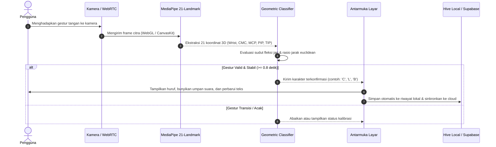

# 🤟 BISINDO AI: Real-Time Indonesian Sign Language Platform

[](https://flutter.dev)
[](https://react.dev)
[](https://tailwindcss.com)
[](https://dart.dev)
[](https://golang.org)
[](https://supabase.com)
[](https://ai.google.dev/edge/mediapipe)
[](https://vitejs.dev)
[](#7-pengujian-dan-verifikasi-kualitas)
[](LICENSE)

Platform penerjemah Bahasa Isyarat Indonesia (BISINDO) secara *real-time* berbasis visi komputer pada perangkat (*edge computing*), ekosistem aplikasi mobile lintas platform (*Android & Web*), portal web responsif dengan simulator interaktif, serta arsitektur backend berkecepatan tinggi dengan sinkronisasi awan terkelola.

---

## 📌 Prinsip Rekayasa & Standar Penilaian

> [!IMPORTANT]
> 1. **Komputasi Tepi & Privasi Penuh (*On-Device Edge Vision*)**: Pelacakan gestur menggunakan MediaPipe Tasks Vision mengekstraksi 21 koordinat 3D sendi tangan langsung pada RAM peramban/ponsel tanpa mengirim rekaman video kamera ke server awan.
> 2. **Klasifikator Geometris Deterministik**: Menerapkan perhitungan matematis sudut fleksi (*joint curl*), proyeksi vektor, serta gerbang validasi keras (*hard boundary gates*) untuk mengisolasi gestur jempol terbuka (*thumbs up*), kepalan tinju (*fist*), maupun diferensiasi abjad kritis (seperti pemisahan persilangan jari `X` vs segitiga jempol `A`).
> 3. **Arsitektur Bersih (*Clean Architecture* & SOLID)**: Kode klien mobile dipisahkan menjadi *Domain*, *Data*, dan *Presentation*. Backend Golang menerapkan standar MVC dengan prinsip *Single Responsibility* dan *Dependency Inversion*.
> 4. **Ketahanan *Offline-First***: Penyimpanan lokal menggunakan NoSQL biner Hive untuk pencatatan instan tanpa jeda, yang disinkronkan secara otomatis ke Supabase PostgreSQL saat koneksi internet aktif.

---

## 1. Identitas Proyek & Tim Pengembang

* **Nama Platform**: **BISINDO AI** (*Indonesian Sign Language Vision & Learning Ecosystem*)
* **Mata Kuliah**: Pemrograman Mobile (Tugas Besar Semester 7)
* **Anggota Tim**:
  1. **MUHAMMAD FAIZ RAMADHAN** (NIM: `2305072`) - *Lead Developer, Mobile & Vision Architect*
  2. **NAILYAA DLIYAA’AN SYAH** (NIM: `2305075`) - *Backend Engineer, Cloud & UI/UX Specialist*

---

## 2. Struktur Repositori (Monorepo Overview)

```
.
├── frontend/               # Portal Web & Landing Page (React 19 + Tailwind v4 + Vite)
│   ├── public/             # Aset statis, foto editorial, favicon, dan logo.svg
│   ├── src/
│   │   ├── components/     # Navbar, HeroSection, SuiteSection, DarkFeatureBand,
│   │   │                   # AtmosphericBanner, DocumentationSection, DocsModal,
│   │   │                   # BrandLogo, StoreIcons, BentoInsightCards
│   │   ├── App.jsx         # Root dashboard landing page
│   │   └── index.css       # Tailwind v4 theme & token visual
│   └── vite.config.js      # Konfigurasi bundler Vite
│
├── mobile/                 # Aplikasi Mobile & Web Client (Flutter 3.x + Dart)
│   ├── lib/
│   │   ├── core/           # Tema, palet warna, dependensi injeksi, reusable widgets
│   │   └── features/
│   │       ├── translate/  # Deteksi kamera, MediaPipe interop, klasifikator 21-titik
│   │       ├── learn/      # Modul pembelajaran abjad, angka, dan tata isyarat
│   │       ├── history/    # Riwayat terjemahan offline-first (Hive) & sinkronisasi
│   │       └── navigation/ # Floating Island Dock navigasi utama
│   ├── test/               # Unit & widget test (100% pass)
│   └── web/                # Runner WebAssembly & WebGL MediaPipe
│
├── backend/                # Server REST API Berkecepatan Tinggi (Golang 1.22+)
│   ├── controllers/        # HTTP handler & request validation
│   ├── services/           # Aturan bisnis & orkestrasi sinkronisasi
│   ├── repositories/       # Abstraksi koneksi basis data Supabase
│   ├── models/             # Definisi entitas data & skema JSON
│   └── main.go             # Entrypoint server Go
│
├── datasets/               # Metadata & referensi koordinat landmark BISINDO
└── DESIGN.md               # Spesifikasi sistem desain & panduan token visual
```

---

## 3. Fitur Utama Platform

| Fitur | Deskripsi Teknis |
|---|---|
| **Terjemahan Visi Real-Time** | Memproses umpan video kamera pada 30-60 FPS, memetakan 21 koordinat spasial tangan, mendeteksi abjad A-Z BISINDO, dan merangkai kata dengan konfirmasi waktu tunggu (*dwell timer*). |
| **Penyaring Anti Gestur Palsu** | Memvalidasi sudut bukaan jempol, kelurusan telunjuk, dan fleksi jari tengah/manis/kelingking untuk menolak gerakan acak non-isyarat. |
| **Simulator Kamera Web** | Modal simulator interaktif langsung di portal web untuk menguji inferensi kinematik tangan tanpa konfigurasi lingkungan rumit. |
| **Katalog Belajar Interaktif** | Modul pembelajaran abjad A-Z, angka 1-5, dan kosakata dasar BISINDO lengkap dengan ilustrasi posisi sendi dan tips artikulasi tangan. |
| **Penyimpanan Offline-First** | Penyimpanan riwayat terjemahan instan ke Hive Box lokal, didukung sinkronisasi latar belakang ke Supabase PostgreSQL. |
| **Sintesis Suara (TTS)** | Mengonversi hasil terjemahan huruf dan kata menjadi suara vokal Bahasa Indonesia yang jernih. |
| **Portal Dokumentasi Terpadu** | Penjelasan teknis mengenai topologi 21 landmark, kontrak REST API, dan parameter penyesuaian sudut sendi. |

---

## 4. Arsitektur Sistem & Alur Data

### 4.1. Diagram Arsitektur Berlapis

```
┌────────────────────────────────────────────────────────────────────────┐
│                   KLIEN 1: FLUTTER MOBILE & WEB APP                    │
│   [Presentation] TranslatePage, LearnPage, HistoryPage, BLoC           │
│   [Domain]       Entities, UseCases, Repositories (Pure Dart)          │
│   [Data]         Hive NoSQL, MediaPipe Web Interop, REST Client        │
└───────────────────────────────────┬────────────────────────────────────┘
                                    │
                                    │ HTTP REST API
                                    ▼
┌────────────────────────────────────────────────────────────────────────┐
│                   KLIEN 2: PORTAL WEB & SIMULATOR                      │
│   [Vite + React 19] Hero, Suite, Kinematika, Dokumentasi, BrandLogo    │
│   [Tailwind CSS v4] Sistem token Superhuman Editorial                  │
└───────────────────────────────────┬────────────────────────────────────┘
                                    │
                                    │ REST API
                                    ▼
┌────────────────────────────────────────────────────────────────────────┐
│                       BACKEND SERVER (GOLANG)                          │
│   [MVC + SOLID]  Controller -> Service -> Repository -> Presenter     │
│   [Middleware]   CORS Protection, Rate Limiting, Request Logger        │
└───────────────────────────────────┬────────────────────────────────────┘
                                    │
                                    │ HTTPS (Service Key & RLS)
                                    ▼
┌────────────────────────────────────────────────────────────────────────┐
│                    BASIS DATA AWAN (SUPABASE)                          │
│   PostgreSQL Engine | Row Level Security (RLS) | Indeks Waktu Otomatis │
└────────────────────────────────────────────────────────────────────────┘
```

### 4.2. Alur Deteksi & Klasifikasi Kinematik



---

## 5. Skema Basis Data (Supabase PostgreSQL)

```sql
-- Tabel Riwayat Terjemahan (History)
create table if not exists public.history (
    id text primary key,
    text text not null,
    confidence double precision not null default 0.95,
    timestamp timestamptz not null default now()
);
create index if not exists idx_history_timestamp on public.history (timestamp desc);

-- Tabel Materi Pembelajaran (Learn Materials)
create table if not exists public.learn_materials (
    id text primary key,
    title text not null,
    description text not null,
    category text not null,
    created_at timestamptz not null default now()
);
create index if not exists idx_learn_materials_category on public.learn_materials (category);

-- Keamanan Data: Row Level Security (RLS)
alter table public.history enable row level security;
alter table public.learn_materials enable row level security;

create policy "Allow read access to all" on public.history for select using (true);
create policy "Allow insert access to all" on public.history for insert with check (true);
create policy "Allow delete access to all" on public.history for delete using (true);
create policy "Allow read access to learn materials" on public.learn_materials for select using (true);
```

---

## 6. Panduan Instalasi & Menjalankan

### Prasyarat Perangkat Lunak
* **Flutter SDK**: Versi 3.x ke atas
* **Node.js**: Versi 20.x ke atas (dengan NPM)
* **Go**: Versi 1.22 ke atas
* **Google Chrome**: Mendukung akselerasi perangkat keras WebGL & WebRTC

---

### 6.1. Menjalankan Portal Web & Landing Page (Frontend)

```bash
cd frontend
npm install
npm run dev
# Akses portal landing page pada http://localhost:3000
```

Untuk memverifikasi kompilasi produksi:
```bash
npm run build
```

---

### 6.2. Menjalankan Klien Mobile / Web (Flutter)

```bash
cd mobile
flutter pub get

# Menjalankan pada peramban Chrome
flutter run -d chrome

# Menjalankan pada perangkat Android yang terhubung
flutter run -d android
```

---

### 6.3. Menjalankan Backend API (Golang)

```bash
cd backend
go mod download
go run main.go
# Server aktif pada http://localhost:8080
```

---

## 7. Pengujian dan Verifikasi Kualitas

Semua modul telah melalui serangkaian pengujian terstruktur untuk menjamin keandalan kode:

### Unit Test Klasifikator Kinematik (Flutter)
```bash
cd mobile
flutter test test/features/translate/bisindo_landmark_classifier_test.dart
```
*Hasil Verifikasi*: **8 dari 8 skenario pengujian sukses (100% PASS)**:
- Uji isolasi huruf `A` (jempol keluar, 4 jari tertekuk).
- Uji isolasi huruf `B` (jempol menekuk di telapak, 4 jari lurus).
- Uji isolasi huruf `C` (lengkungan cembung presisi).
- Uji isolasi huruf `L` (tegak lurus antara telunjuk dan jempol).
- Uji isolasi jempol terbuka (*Thumbs Up*) tanpa salah mendeteksi abjad lain.
- Uji isolasi kepalan tangan (*Fist*) untuk menolak masukan acak.
- Uji penolakan telapak tangan terbuka biasa (*Open Hand Rejection*).

### Unit Test Backend (Go)
```bash
cd backend
go test -v ./...
```

### Static Analysis
```bash
cd mobile
flutter analyze
```

---

## 8. Lisensi & Hak Cipta

Proyek ini dikembangkan dalam rangka Tugas Besar Pemrograman Mobile Semester 7 Tahun Akademik 2026/2027.  
Seluruh kode sumber dilisensikan di bawah lisensi terbuka [MIT License](LICENSE).
